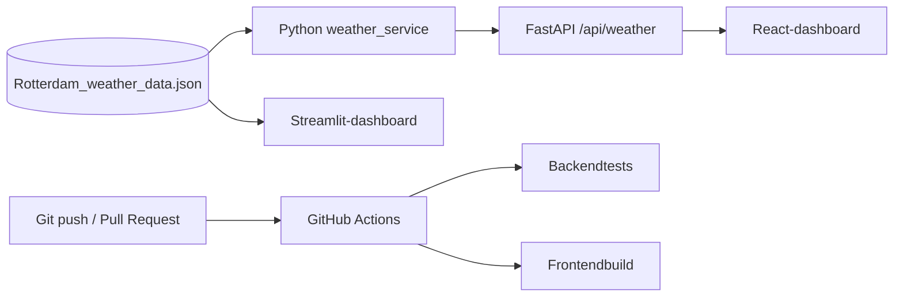
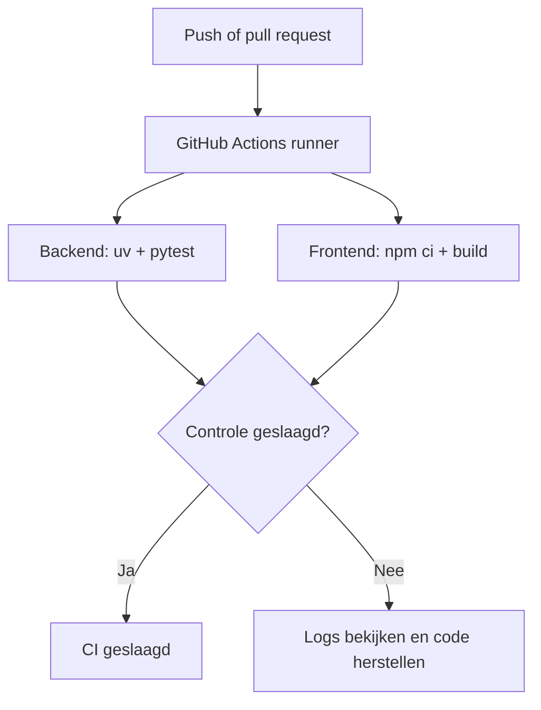

# Weather App — Dashboard & API Learning Project

Een leerproject om **weerdata uit JSON te verwerken en te presenteren via verschillende dashboards**, met aandacht voor **FastAPI, React, Streamlit, testen en Continuous Integration (CI)**.

**Repository:** https://github.com/JoKzsevn/Weather_app_exp  
**Status:** lokaal ontwikkelproject; de aanwezigheid van een CI-workflow betekent niet dat de app al online gedeployed is.

## Inhoud

- [Wat kun je ermee?](#wat-kun-je-ermee)
- [Architectuur](#architectuur)
- [Projectstructuur](#projectstructuur)
- [Benodigdheden](#benodigdheden)
- [Installeren](#installeren)
- [Streamlit-dashboard starten](#streamlit-dashboard-starten)
- [FastAPI en React starten](#fastapi-en-react-starten)
- [API en weerdata](#api-en-weerdata)
- [Testen en codekwaliteit](#testen-en-codekwaliteit)
- [GitHub Actions CI](#github-actions-ci)
- [Probleemoplossing](#probleemoplossing)
- [Roadmap](#roadmap)

## Wat kun je ermee?

Je kunt dezelfde opgeslagen weergegevens op twee manieren bekijken:

| Methode | Technologie | Gebruik |
| --- | --- | --- |
| Python-dashboard | **Streamlit** | Snel een interface bouwen met alleen Python |
| Full-stack dashboard | **FastAPI + React/Vite** | Backend-API en frontend apart ontwikkelen |

In de huidige opzet wordt het lokale bestand `data/Rotterdam_weather_data.json` gelezen. **De app vraagt niet automatisch bij elke paginalading nieuwe data op bij Xweather.** De API-integratie voor live updates kan later worden toegevoegd.

## Architectuur



> Streamlit leest in de bestaande versie zelf de weergegevens. FastAPI en React volgen een gescheiden service/API/frontend-opzet.

## Projectstructuur

```text
weather_project/
├── .github/
│   └── workflows/
│       └── ci.yml
├── dashboard_SandBox/
│   ├── streamlit_app.py
│   └── react_app/
│       ├── src/
│       │   ├── App.jsx
│       │   ├── App.css
│       │   └── main.jsx
│       ├── package.json
│       ├── package-lock.json
│       └── vite.config.js
├── data/
│   └── Rotterdam_weather_data.json
├── prep/
│   └── prep_01.ipynb
├── src/
│   └── weather_project/
│       ├── api/main.py
│       └── services/weather_service.py
├── tests/
│   ├── test_api.py
│   └── test_weather_service.py
├── .python-version
├── pyproject.toml
├── uv.lock
└── README.md
```

De **projectroot** is de map waarin `pyproject.toml` en `uv.lock` staan. Voer backendcommando's vanuit deze map uit.

## Benodigdheden

- Ubuntu/Linux (de commando's hieronder zijn Bash-commando's).
- Git en [uv](https://docs.astral.sh/uv/).
- Python **3.12 of hoger** volgens `pyproject.toml` (voor reproduceerbaarheid: gebruik de versie uit `.python-version`).
- Node.js en npm voor de React-frontend. Gebruik een Node-versie die geschikt is voor de geïnstalleerde Vite-versie.

Controleer je installatie:

```bash
git --version
uv --version
node --version
npm --version
```

## Installeren

### 1. Repository ophalen

```bash
git clone https://github.com/JoKzsevn/Weather_app_exp.git
cd Weather_app_exp
```

Heb je het project al lokaal? Ga naar je bestaande map, bijvoorbeeld:

```bash
cd ~/Documents/Projects/weather_project
```

> **Bestaand uv-project:** voer niet opnieuw `uv init` uit.

### 2. Python-dependencies installeren

```bash
uv sync --locked --dev
```

`uv` maakt of synchroniseert de `.venv/` op basis van `pyproject.toml` en `uv.lock`. Als je bewust dependencies wijzigt, gebruik dan `uv add ...` en commit het bijgewerkte lockbestand.

### 3. React-dependencies installeren

```bash
cd dashboard_SandBox/react_app
npm ci
cd ../..
```

`npm ci` gebruikt `package-lock.json`. `uv` beheert Python; `npm` beheert JavaScript. Installeer React niet met `uv`.

## Streamlit-dashboard starten

Voer vanuit de projectroot uit:

```bash
uv run streamlit run dashboard_SandBox/streamlit_app.py
```

Open de URL die Streamlit toont; standaard is dat **http://localhost:8501**.

Stop de server met **Ctrl+C** in de betreffende terminal.

## FastAPI en React starten

Open **twee terminals**. Beide servers moeten blijven draaien zolang je het React-dashboard gebruikt.

### Terminal 1 — FastAPI-backend

Vanuit de projectroot:

```bash
uv run uvicorn weather_project.api.main:app --app-dir src --reload
```

Controleer:

- **http://127.0.0.1:8000/** — basisendpoint.
- **http://127.0.0.1:8000/api/weather** — JSON-response met weerdata.
- **http://127.0.0.1:8000/docs** — interactieve Swagger API-documentatie.

### Terminal 2 — React-frontend

```bash
cd dashboard_SandBox/react_app
npm run dev
```

Open de URL die Vite toont, normaal **http://localhost:5173**.

De React-app haalt via `fetch('/api/weather')` de gegevens op. De Vite-developmentproxy in `vite.config.js` stuurt `/api` door naar de FastAPI-server op poort 8000. Daarom moeten beide servers actief zijn.

> **Let op:** de Vite-developmentproxy is bedoeld voor lokale ontwikkeling. Een productiebuild vereist een aparte inrichting voor de API-route.

### Overzicht van de lokale adressen

| Dienst | Gebruikelijke URL |
| --- | --- |
| Streamlit | `http://localhost:8501` |
| FastAPI | `http://127.0.0.1:8000` |
| Swagger UI | `http://127.0.0.1:8000/docs` |
| React (Vite) | `http://localhost:5173` |

## API en weerdata

### Endpoint

`GET /api/weather`

**Voorbeeldresponse** (illustratieve waarden uit de eerdere test):

```json
{
  "date_time": "2026-11-08T17:04:00+01:00",
  "temperature": 8.9,
  "feels_like": 8.9,
  "humidity": 82,
  "wind_direction": "S",
  "visibility": 8,
  "weather": "Cloudy",
  "weather_primary": "Cloudy",
  "timezone": "Europe/Amsterdam"
}
```

De daadwerkelijke output is afhankelijk van `data/Rotterdam_weather_data.json`. De Weather Service kiest in deze opzet de **eerste `period`** uit de eerste `response`, niet automatisch de meest recente meting.

### JSON-bestand vernieuwen

Vervang of actualiseer `data/Rotterdam_weather_data.json` met dezelfde verwachte Xweather-structuur. Controleer daarna het endpoint opnieuw en vernieuw het dashboard in je browser. Bij een ontbrekend bestand kan de API `404` teruggeven; bij ongeldige of onvolledige data `500`.

Bewaar eventuele Xweather API-sleutels in een lokaal `.env`-bestand dat niet wordt gecommit. Zet nooit credentials in frontendcode: die is zichtbaar voor bezoekers.

## Testen en codekwaliteit

### Backendtests

Vanuit de projectroot:

```bash
PYTHONPATH=src uv run pytest -v
```

Coverage berekenen:

```bash
PYTHONPATH=src uv run pytest -v \
  --cov=weather_project \
  --cov-report=term-missing
```

Een minimale coveragegrens van 80% controleren:

```bash
PYTHONPATH=src uv run pytest -v \
  --cov=weather_project \
  --cov-report=term-missing \
  --cov-fail-under=80
```

Een eerdere lokale uitvoering rapporteerde **3 geslaagde tests en 81% statement coverage**. Dit is een historische momentopname, geen garantie voor de huidige versie.

### React controleren en bouwen

```bash
cd dashboard_SandBox/react_app
npm run lint
npm run build
```

`npm run build` maakt een productiebuild in `dist/`, maar test niet automatisch of het dashboard in een browser correct met FastAPI communiceert.

### Optioneel: Ruff

Ruff is niet in alle projectversies als dependency opgenomen. Voeg het indien gewenst toe:

```bash
uv add --dev ruff
uv run ruff check src tests
uv run ruff format --check src tests
```

### Waarom mockdata gebruiken?

Unit- en API-tests moeten bij voorkeur niet afhankelijk zijn van live Xweather-verzoeken of een veranderend JSON-bestand. Gebruik fixtures en `monkeypatch` om vaste testdata en foutscenario's na te bootsen.

## GitHub Actions CI

De workflow staat in **`.github/workflows/ci.yml`** en is bedoeld om bij pushes en/of pull requests automatisch controles uit te voeren. Bekijk het bestand voor de exacte triggers en stappen in jouw versie.

Conceptueel:



Bekijk de uitvoeringen in de [Actions-tab van de repository](https://github.com/JoKzsevn/Weather_app_exp/actions).

Een geslaagde CI-run betekent **niet** dat het dashboard automatisch is gedeployed. Deployment/CD moet afzonderlijk worden ingericht.

### Wijzigingen committen

```bash
git status
git add .
git commit -m "docs: document Weather App setup and usage"
git push origin main
```

Controleer vooraf dat `.env`, tokens, `node_modules/` en `.venv/` niet zijn opgenomen.

## Probleemoplossing

| Probleem | Controle of oplossing |
| --- | --- |
| `ModuleNotFoundError: weather_project` | Start Uvicorn met `--app-dir src`; gebruik voor tests `PYTHONPATH=src`. |
| `FileNotFoundError` voor JSON | Controleer of `data/Rotterdam_weather_data.json` bestaat in de projectroot. |
| React toont geen data | Start FastAPI eerst; bezoek `/api/weather` rechtstreeks; controleer de browser Network-tab. |
| `404` op `/api/weather` in React | Controleer `vite.config.js` en of de juiste Vite-server draait. |
| `500` vanuit FastAPI | Controleer of de verwachte velden voorkomen in de JSON-data. |
| `npm ci` faalt | Controleer Node-versie en of `package-lock.json` overeenkomt met `package.json`. |
| Poort is bezet | Stop de betreffende server met Ctrl+C of controleer welk proces de poort gebruikt. |
| GitHub Actions rood | Open **Actions**, kies de mislukte job en lees de logs van de falende stap. |


## Documentatie en bronnen

- [FastAPI](https://fastapi.tiangolo.com/)
- [React](https://react.dev/)
- [Vite](https://vite.dev/)
- [Streamlit](https://docs.streamlit.io/)
- [uv](https://docs.astral.sh/uv/)
- [GitHub Actions](https://docs.github.com/en/actions)

---

**Doel van dit project:** verschillende manieren van het bouwen, testen en uitrollen van datagedreven dashboards oefenen, niet alleen een actuele weerapp aanbieden.
